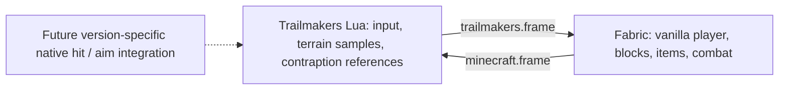

# Architecture and protocol v1

SkyCraft's SKSE renderer, Havok extraction, damage hooks and shared-memory layout are
specific to Skyrim. MineMakers uses a different, portable prototype: a Fabric mod
and documented Trailmakers Lua, communicating through a shared local directory.
Version 0.2 adds a Windows layered-window compositor and explicit desktop input
forwarding, plus transparent export of the real vanilla hand/HUD/GUI. This is an
out-of-process desktop overlay, not a native Trailmakers graphics plugin.
Minecraft owns its world and vanilla rules. Trailmakers owns contraptions and host
physics. The Java singleplayer server drives snapshots; client input is mirrored
through actual vanilla key bindings. Opening a Minecraft screen releases bridged keys.



## Ownership and limits

- Only an explicit `/minemakers link` enables the bridge, and only in integrated
  singleplayer. It uses the existing world in its current dimension; changing
  dimension unlinks it. No worktrees are needed for development; use this checkout.
- Minecraft's link-time block position becomes the integer origin. Trailmakers'
  player position at handshake becomes the host anchor. One block is one metre,
  +Y is up and +Z matches Minecraft south. Host collider rows are origin-relative.
- Vanilla barrier blocks represent sampled host ground. We never overwrite non-air
  Minecraft blocks. Up to 2,048 owned barriers, 512 collider rows and 64 contraption
  proxies are accepted. Native `GetSize()` units are configurable; target sizes are
  exported but currently represented by small invisible slimes, not matching meshes.
- Minecraft snapshots include up to 4,096 solid blocks in a 17×12×17 region and
  nearby projectile/TNT positions. Other block shapes/types are simplified cubes;
  liquids, vegetation, particles, lighting, full chunks and block entities are not rendered.
- Original placeholder world textures provide wood, stone, bedrock, TNT and ten
  crack stages. Minecraft itself now renders the first-person hand and item/HUD/GUI
  layer. The third-person avatar is still a placeholder rather than an exported skin.

## File framing

UTF-8, LF only; fields are TSV. No tabs/newlines inside fields; at most 256 characters
per field, 32 fields per row, 8,192 rows, and 4 MiB per snapshot.

```text
MMT1<TAB>session<TAB>sequence<TAB>rowCount
...rows...
END<TAB>session<TAB>sequence<TAB>rowCount
```

Session tokens contain letters/digits/underscore/hyphen, 1–64 characters. Sequences
increase within a session. Each receiver validates framing before side effects and
ignores repeated snapshots. Java writes via atomic replacement when the filesystem
supports it. Lua's API only writes text in place, so readers reject torn frames.
A two-second lack of a *new* valid frame disconnects even if an old file remains.
Java I/O uses a daemon worker; Minecraft world changes stay on the server thread.

The host first writes an empty frame. Java echoes its token in `HOST_SESSION`.
Lua only accepts Minecraft snapshots echoing the current token, preventing an old
leftover file from taking control on startup. Lua then sends `LINK <mcSession>`;
Java ignores control/damage rows until this matches its current session.

### Minecraft → Trailmakers rows

| Tag | Fields after tag |
|---|---|
| HOST_SESSION | host session token |
| PLAYER | relative x y z, yaw, pitch, health, creative 0/1, alive 0/1, armor points |
| ORIGIN | absolute Minecraft origin x y z |
| SLOT | slot 0–8, item registry ID, count |
| BLOCK | relative x y z, block registry ID, crack stage -1–9 |
| ENTITY | entity ID, type registry ID, relative x y z |
| EVENT | event ID, HIT, native target ID, damage, direction x y z, knockback, native damage type |
| HOST_ACK | highest applied host event ID |

### Trailmakers → Minecraft rows

| Tag | Fields after tag |
|---|---|
| LINK | current Minecraft session token |
| ACK | highest applied Minecraft event ID |
| INPUT | forward back left right jump sneak attack use (0/1), yaw, pitch, reserved 0, hotbar slot 0–8 |
| COLLIDER | relative min x y z, max x y z |
| TARGET | native target ID, relative x y z, size x y z |
| EVENT | event ID, BLOCK_HIT, relative block x y z, damage, damage type |
| EVENT | event ID, PLAYER_HIT, damage, velocity x y z |

Each side keeps up to 256 pending combat events until acknowledged. Applying a
repeated event cannot cause a second hit. Sessions reset deduplication state. The
current local pair is trusted; this is not an authenticated multiplayer protocol.

## Required native integration

The referenced public Lua API exposes `ModBlock.DoDamageAmount`, structure impulse,
custom-object spawning, raycasts, native player death, and invincibility. It does
**not** expose custom-object incoming weapon-hit notifications, nonfatal player
hit interception, complete physics mesh extraction, or custom aim-target registration.

The Lua functions `MineMakersNativeBlockHit(x,y,z,damage,type)` and
`MineMakersNativePlayerHit(damage,vx,vy,vz)` enqueue reliable incoming-hit events.
They need a version-specific native plugin to observe the real engine hit *before*
native destruction, identify the registered voxel/player, and forward exactly one
event per impact. They are not automatically connected by the Lua mod. The plugin
must also register/maintain native targeting and resolve collisions against moving
contraption meshes. This work requires the installed Trailmakers runtime, matching
managed API assemblies or supported native extension documentation, and in-game testing.
No fabricated game class names or unverified native patches are included here.

Incoming block damage accumulates in `BlockDamage`: maximum health derives from
hardness, resistance from blast resistance, each hit is capped at 35% max health,
and hardness-negative blocks/bedrock are immune. Damage stages reset when the block
state changes. Vanilla mining, player TNT and item behavior stay vanilla; the 35%
cap applies to forwarded native weapon hits, not every kind of Minecraft destruction.

The native player's death callback forwards a lethal generic Minecraft hit as a
coarse fallback only. Armor cannot prevent a native death after it has already
happened. Do not describe it as accurate two-way combat. Native auto-aim behavior
against the retained native player has not been tested.

## References

- [SkyCraft](https://github.com/chasmlol/SkyCraft), bfcaf178524b92c2cdeb88e4ce0f13ef9ded6f32.
- [Trailmakers API LuaLS definitions](https://github.com/ALVAROPING1/Trailmakers-API-LuaLS),
  bd97bccf9dfc42911f78b59fdcbf10ab0bee1129 (see repository history for current API changes).
- [Official modding documentation](https://flashbulb.atlassian.net/wiki/spaces/TMMOD/overview).

Generate the actual installed API documentation with `tm.GetDocs()` before changing
runtime bindings. Community definitions and our fake API are evidence for signatures,
not proof of behavior on a particular installed Trailmakers version.


## 0.2 camera and desktop rendering

`view.frame` uses the same MMT1 framing and Minecraft session token as scene output.
Its single `VIEW x y z yaw pitch eyeHeight menuOpen` row is published by the client
at tick rate, independently of the 5 Hz scene/block export. Lua creates a custom
first-person camera, places it at the real eye height, and converts Minecraft look
to a Unity direction vector. Disconnect removes only this owned camera. A slower
scene snapshot cannot rewind an already-received view. The native body is rotated
with the view and avatar cubes are hidden in first person.

When Minecraft has focus, the legacy input bridge leaves its controls and view
alone. Otherwise the Windows desktop input has priority over the Lua keyboard
fallback. The fallback uses J/L and Up/Down for view rotation; it no longer reads
an unrotated native third-person body transform as authoritative look input.

`tools/desktop_overlay.py` uses documented Win32 layered-window, low-level keyboard/
button hook, and raw mouse APIs. F8 explicitly arms it while Trailmakers is the
foreground window; inputs are not logged or forwarded from other applications.
Alt-Tab/Windows keys release capture. No DLL injection or game assemblies are used.
Raw relative mouse motion supports a virtual GUI cursor even if Trailmakers locks
the OS cursor. The helper requires Windows and windowed/borderless Trailmakers.

It writes `desktop.frame` with its own UUID session and increasing sequence:

| Row | Fields after tag |
|---|---|
| ACTIVE | 0/1 |
| POINTER | cumulative mouse x y, normalized GUI cursor x y |
| HELD | one GLFW key code per row |
| EVENT | event ID, KEY, GLFW key, action 0/1/2, modifier bits |
| EVENT | event ID, CHAR, Unicode BMP code point |
| EVENT | event ID, BUTTON, button 0/1/2, action 0/1, modifiers, normalized cursor x y |
| EVENT | event ID, SCROLL, vertical wheel steps |

Events remain until acknowledged in rendered frames; each is handled at most once.
Held-state snapshots reconcile dropped releases, and input expires after 750 ms
without a new frame. Cumulative look totals prevent lost mouse deltas when snapshots
are skipped. Screen key/click/drag/scroll callbacks are vanilla Minecraft handlers.
An `InputUtil.isKeyPressed` hook exposes captured modifiers to vanilla shift-click,
control shortcuts and other screen logic. Capture keeps `isPaused()` false so the
singleplayer server does not freeze its scene stream while menus are open.

While desktop capture is active, the game renderer clears color/depth immediately
before vanilla first-person hand rendering. The real hand, item, hotbar, hearts,
chat and current screen then render onto transparent color. Destination-color
vignette and full-frame blur are suppressed because they otherwise make the whole
export opaque. First-person perspective is selected during capture and the old
perspective is restored on release. This path targets vanilla rendering; shader
and renderer replacement mods are not validated.

`overlay.bgra` is atomic binary output, at most 1280×720 and 15 FPS. The 100-byte
little-endian header is `<4sIIIQQI64s`: `MMOV`, version 1, width, height, image
sequence, acknowledged desktop event ID, flags (bit 0 = menu open), and zero-padded
ASCII desktop session token. Bottom-up BGRA pixel rows follow. GL blending produces
premultiplied color suitable for Win32 `UpdateLayeredWindow`.

The helper rejects oversized/truncated/stale images and images for another desktop
session. It scales the image to Trailmakers' client rectangle and draws a virtual
cursor over vanilla menus. A frozen image cannot keep input captured indefinitely.
No desktop/global screen capture is performed; only Minecraft's own framebuffer
is exported by the mod.

Actual Minecraft hand/HUD export, inventory opening, remote slot clicks, mouse look
and pause-menu liveness were exercised under Xvfb/Mesa. The Win32 compositor and
Trailmakers-side camera remain untested on this Linux cloud machine.
