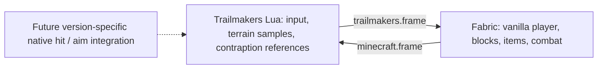

# Architecture and protocol v1

SkyCraft's SKSE renderer, Havok extraction, damage hooks and shared-memory layout are
specific to Skyrim. MineMakers uses a different, portable prototype: a Fabric mod
and documented Trailmakers Lua, communicating through a shared local directory.
Version 0.2 adds a Windows layered-window compositor and explicit desktop input
forwarding, plus transparent export of the real vanilla hand/HUD/GUI. This is an
out-of-process desktop overlay, not a native Trailmakers graphics plugin.
Minecraft owns inventory, item/world interactions, health and game modes. Trailmakers
owns player motion, contraptions and host physics. The Java singleplayer server drives snapshots; client input is mirrored
through actual vanilla key bindings. Opening a Minecraft screen releases bridged keys.



## Ownership and limits

- Only an explicit `/minemakers link` enables the bridge, and only in integrated
  singleplayer. It transfers the linked player into the dedicated host dimension; changing
  dimension after linking unlinks it. No worktrees are needed for development; use this checkout.
- Minecraft uses origin (0,128,0) in the isolated `minemakers:trailmakers` dimension.
  Trailmakers player position at handshake becomes the host anchor. One block is
  one metre; +Y is up and +Z matches south. X is reflected at every host conversion
  because Minecraft and Unity have opposite handedness.
- Vanilla barrier blocks represent sampled host ground for item targeting,
  independently of player physics. We never overwrite non-air
  Minecraft blocks. Up to 2,048 owned barriers, 512 collider rows and 64 contraption
  proxies are accepted. Native `GetSize()` units are configurable; target sizes are
  exported but currently represented by small invisible slimes, not matching meshes.
- Minecraft snapshots include up to 4,096 solid blocks in a 17×12×17 region for
  invisible native collision cubes. Non-cube collision shapes remain approximate.
  Minecraft renders the actual placed block models, selection outlines, breaking
  cracks, entities, particles and held items directly. Native placeholder textures
  are retained for collision object creation and the optional legacy avatar.
- The transparent world pass retains vanilla geometry but suppresses the sky,
  weather, clouds, world border, distance fog, vignette and full-frame menu blur.
  It clears before world geometry, rather than erasing the world before the hand.
  Camera position/orientation use the latest host pose every render, bypassing
  20 Hz player interpolation; view bobbing is suppressed to keep layers aligned.
  CAMERA_FOV (vertical degrees, config default 60) matches the custom host lens.
  Both windows must have the same aspect ratio. Depth is not shared between games;
  Minecraft objects behind native terrain can still draw over it.

## File framing

UTF-8, LF only; fields are TSV. No tabs/newlines inside fields; at most 256 characters
per field, 32 fields per row, 8,192 rows, and 4 MiB per snapshot.

```text
MMT1<TAB>session<TAB>sequence<TAB>rowCount
...rows...
END<TAB>session<TAB>sequence<TAB>rowCount
```

Session tokens contain letters/digits/underscore/hyphen, 1–64 characters. Sequences
increase within a session. Each receiver validates framing before side effects and
ignores repeated snapshots. Java writes via atomic replacement when the filesystem
supports it. Lua's API only writes text in place, so readers reject torn frames.
A two-second lack of a *new* valid frame disconnects even if an old file remains.
Java I/O uses a daemon worker; Minecraft world changes stay on the server thread.

The host first writes an empty frame. Java echoes its token in `HOST_SESSION`.
Lua only accepts Minecraft snapshots echoing the current token, preventing an old
leftover file from taking control on startup. Lua then sends `LINK <mcSession>`;
Java ignores control/damage rows until this matches its current session.

### Minecraft → Trailmakers rows

| Tag | Fields after tag |
|---|---|
| CAPS | HOST_MOTION_1 (required capability) |
| HOST_SESSION | host session token |
| PLAYER | relative x y z, yaw, pitch, health, creative 0/1, alive 0/1, armor points |
| ORIGIN | absolute Minecraft origin x y z |
| SLOT | slot 0–8, item registry ID, count |
| BLOCK | relative x y z, block registry ID, crack stage -1–9 |
| ENTITY | entity ID, type registry ID, relative x y z |
| EVENT | event ID, HIT, native target ID, damage, direction x y z, knockback, native damage type |
| HOST_ACK | highest applied host event ID |

### Trailmakers → Minecraft rows

| Tag | Fields after tag |
|---|---|
| HOST_POSE | resolved relative x y z, yaw, pitch, grounded, flying, crouch |
| LINK | current Minecraft session token |
| ACK | highest applied Minecraft event ID |
| INPUT | forward back left right jump sneak attack use (0/1), yaw, pitch, reserved 0, hotbar slot 0–8 |
| COLLIDER | relative min x y z, max x y z |
| TARGET | native target ID, relative x y z, size x y z |
| EVENT | event ID, BLOCK_HIT, relative block x y z, damage, damage type |
| EVENT | event ID, PLAYER_HIT, damage, velocity x y z |

Each side keeps up to 256 pending combat events until acknowledged. Applying a
repeated event cannot cause a second hit. Sessions reset deduplication state. The
current local pair is trusted; this is not an authenticated multiplayer protocol.

## Required native integration

The referenced public Lua API exposes `ModBlock.DoDamageAmount`, structure impulse,
custom-object spawning, raycasts, native player death, and invincibility. It does
**not** expose custom-object incoming weapon-hit notifications, nonfatal player
hit interception, complete physics mesh extraction, or custom aim-target registration.

The Lua functions `MineMakersNativeBlockHit(x,y,z,damage,type)` and
`MineMakersNativePlayerHit(damage,vx,vy,vz)` enqueue reliable incoming-hit events.
They need a version-specific native plugin to observe the real engine hit *before*
native destruction, identify the registered voxel/player, and forward exactly one
event per impact. They are not automatically connected by the Lua mod. The plugin
must also register/maintain native targeting and resolve collisions against moving
contraption meshes. This work requires the installed Trailmakers runtime, matching
managed API assemblies or supported native extension documentation, and in-game testing.
No fabricated game class names or unverified native patches are included here.

Incoming block damage accumulates in `BlockDamage`: maximum health derives from
hardness, resistance from blast resistance, each hit is capped at 35% max health,
and hardness-negative blocks/bedrock are immune. Damage stages reset when the block
state changes. Vanilla mining, player TNT and item behavior stay vanilla; the 35%
cap applies to forwarded native weapon hits, not every kind of Minecraft destruction.

The native player's death callback forwards a lethal generic Minecraft hit as a
coarse fallback only. Armor cannot prevent a native death after it has already
happened. Do not describe it as accurate two-way combat. Native auto-aim behavior
against the retained native player has not been tested.

## References

- [SkyCraft](https://github.com/chasmlol/SkyCraft), bfcaf178524b92c2cdeb88e4ce0f13ef9ded6f32.
- [Trailmakers API LuaLS definitions](https://github.com/ALVAROPING1/Trailmakers-API-LuaLS),
  bd97bccf9dfc42911f78b59fdcbf10ab0bee1129 (see repository history for current API changes).
- [Official modding documentation](https://flashbulb.atlassian.net/wiki/spaces/TMMOD/overview).

Generate the actual installed API documentation with `tm.GetDocs()` before changing
runtime bindings. Community definitions and our fake API are evidence for signatures,
not proof of behavior on a particular installed Trailmakers version.


## 0.2 camera and desktop rendering

`control.frame` uses MMT1 framing and the Minecraft session token. Its single
`CONTROL forward sideways jump sneak sprint flying creative yaw pitch eyeHeight menu reserved`
row carries current intent at render rate. Lua integrates a local controller in
substeps no larger than 1/120 second, resolving motion against live host rays.
`HOST_POSE` returns the result. Only the linked Minecraft player has `Entity.move`
and server move-packet processing cancelled; it follows that result without a
second physics solver. Unlinked worlds and players are unchanged; supported host projectiles also use native surface queries.
Scene snapshots never overwrite host position. Reliable TELEPORT and PUSH events
carry absolute Minecraft teleports and incoming knockback back to Lua; PLAYER_FALL
reports host landing distance to Minecraft health logic.

Camera position comes directly from the host controller, not a Minecraft return
trip. Camera creation falls back from the four-argument priority API to the earlier
three-argument overload. Activation occurs once per link. The retained native body
is hidden, static and a trigger so it cannot intercept collision rays or compete
with movement. Disconnect restores body/build/repair settings and removes the camera.

Linking transfers the Minecraft player into the dedicated empty host dimension;
unlink returns it to its original world and pose. Temporary barriers and blocks
are confined to that dimension. No ordinary Minecraft terrain can enter the host
player's collision path. Host motion freezes while no fresh control arrives.

Ray probes are an approximation, not capsule casts. Thin features between probes,
penetration by fast moving contraptions, and riding moving platforms are limitations.

When Minecraft has focus, the legacy input bridge leaves its controls and view
alone. Otherwise the Windows desktop input has priority over the Lua keyboard
fallback. The fallback uses J/L and Up/Down for view rotation; it no longer reads
an unrotated native third-person body transform as authoritative look input.

`tools/desktop_overlay.py` uses documented Win32 layered-window, low-level keyboard/
button hook, and raw mouse APIs. F8 explicitly arms it while Trailmakers is the
foreground window; inputs are not logged or forwarded from other applications.
Alt-Tab/Windows keys release capture. No DLL injection or game assemblies are used.
Raw relative mouse motion supports a virtual GUI cursor even if Trailmakers locks
the OS cursor. The helper requires Windows and windowed/borderless Trailmakers.

It writes `desktop.frame` with its own UUID session and increasing sequence:

| Row | Fields after tag |
|---|---|
| ACTIVE | 0/1 |
| POINTER | cumulative mouse x y, normalized GUI cursor x y |
| HELD | one GLFW key code per row |
| EVENT | event ID, KEY, GLFW key, action 0/1/2, modifier bits |
| EVENT | event ID, CHAR, Unicode BMP code point |
| EVENT | event ID, BUTTON, button 0/1/2, action 0/1, modifiers, normalized cursor x y |
| EVENT | event ID, SCROLL, vertical wheel steps |

Events remain until acknowledged in rendered frames; each is handled at most once.
Held-state snapshots reconcile dropped releases, and input expires after 750 ms
without a new frame. Cumulative look totals prevent lost mouse deltas when snapshots
are skipped. Screen key/click/drag/scroll callbacks are vanilla Minecraft handlers.
An `InputUtil.isKeyPressed` hook exposes captured modifiers to vanilla shift-click,
control shortcuts and other screen logic. Capture keeps `isPaused()` false so the
singleplayer server does not freeze its scene stream while menus are open.

While desktop capture is active, the game renderer clears to transparent before
world geometry. Vanilla blocks, selection lines, crack stages, projectiles, hand,
HUD and screens remain in the framebuffer. Sky/weather/clouds, fog, view bobbing,
vignette and blur are suppressed. First person is selected during capture and the
old perspective is restored on release. This path targets vanilla rendering;
shader and renderer replacement mods are not validated.

`overlay.shared` is a fixed 11,059,624-byte READ_WRITE file mapping. Java and Python
map the same local pages; no per-frame flush, file write/rename, or reopen is needed.
The header is `MMMF`, version 1, three slots, maximum payload 3,686,500 bytes. An
aligned little-endian uint64 descriptor at offset 16 publishes `(serial << 2)|slot`.
Slots start at 64 with stride 3,686,520: uint64 epoch at +0, uint32 length at +8,
payload at +16. Writer marks epoch `serial*2-1`, writes the image, release-commits
`serial*2`, then release-publishes the descriptor. Reader checks the epoch before
and after copying and retries a torn slot. Latest-frame selection bounds latency.
The producer retains ownership of its buffer until the copy finishes.

Each payload retains the 100-byte little-endian `<4sIIIQQI64s` header: `MMOV`,
version 1, width, height, image sequence, acknowledged desktop event ID, flags
(bit 0 = menu open), and zero-padded ASCII desktop session token. Bottom-up BGRA
pixels follow, at most 1280×720. GL blending supplies premultiplied color for Win32
`UpdateLayeredWindow`. The updated helper can read legacy `overlay.bgra` only when
no shared mapping exists. Do not mix old/new components; stop both games/helper
before removing an obsolete mapping.

The helper rejects oversized/truncated/stale images and images for another desktop
session. It scales the image to Trailmakers' client rectangle and draws a virtual
cursor over vanilla menus. A frozen image cannot keep input captured indefinitely.
No desktop/global screen capture is performed; only Minecraft's own framebuffer
is exported by the mod.

Actual Minecraft hand/HUD export, inventory opening, remote slot clicks, mouse look
and pause-menu liveness were exercised under Xvfb/Mesa. The Win32 compositor and
Trailmakers-side camera remain untested on this Linux cloud machine.

## 0.3.1 startup and capture recovery

Scene rendering errors are caught after the core handshake; they cannot restart
the owned camera. Asset imports are relative to the mod root and explicitly use
`data_static/`. The real root API does not contain `tm.enums`; named material/force
values are supplied directly. First person does not spawn the third-person avatar.
Optional native API state calls are isolated and recorded in the status file.

Control and capture scheduling retain deadlines across small frame-time variation.
Overlay buffers are recycled only after the image writer releases them; replacing
the single pending frame drops older pixels without reusing a writer-owned buffer.
This removes per-frame multi-megabyte heap allocation and a read/clear race in the
previous volatile handoff. The helper enables precise Windows timer resolution
while armed and restores it on release. Frame timing is reported in
`minemakers-client-status.txt`; native Windows performance remains to be measured.

## 0.4 native queries and independent input

Minecraft publishes `projectiles.frame` at server tick rate through the fast bridge
worker. Each bounded `PROJECTILE uuid probeSequence startX startY startZ endX endY
endZ` row represents an arrow, vanilla thrown item or primed TNT motion segment,
relative to the host origin. Lua raycasts those segments against actual native
surfaces, including the hidden block colliders, and reliably returns `EVENT id
PROJECTILE_HIT uuid probeSequence hitX hitY hitZ normalX normalY normalZ`.
Java verifies the hit against a retained probe and invokes vanilla projectile
impact logic; arrows remain anchored at native impacts for up to 60 seconds and
can be picked up. TNT bounces with damped velocity while retaining its vanilla fuse.
Minecraft block collision is bypassed for those entities only in the host dimension.
Entity hits and existing contraption combat proxies still use vanilla logic.
Queries are point sweeps at 20 Hz with a round-trip correction delay; they do not
supply rigid-body mesh physics or native explosion occlusion.

`control.frame` additionally carries `DESKTOP_LOOK desktopSession appliedMouseX
appliedMouseY yawScale pitchScale` and `KEYMAP action glfwKey`. Lua reads matching
fresh `desktop.frame` input directly each update, applying the mouse delta beyond
Minecraft's acknowledged baseline. Native camera/movement no longer wait for
Minecraft rendering. When the baseline advances the delta is not applied twice.
Menus and stale/mismatched sessions stop movement. Unsupported mouse/scancode
movement bindings use the normal Minecraft CONTROL fallback.

Client status reports render/capture/mapping-write FPS. The Windows helper reports
read/present/input FPS and average copy/composition duration separately in
`minemakers-overlay-status.txt`. A slow compositor can therefore be distinguished
from a slow game renderer or transport.

## 0.4.1 render-time camera synchronization

Raw physics remains `HOST_POSE`. `POSE_CLOCK hostSeconds teleportEpoch` timestamps
that pose at the native integration time. `PoseTimeline` keeps a bounded history,
aligns the host clock using minimum observed arrival offset, and samples at an
adaptive 25–100 ms delay. It interpolates between samples and holds the final pose
on a stall; it never extrapolates through native geometry. Teleports, large jumps,
clock reversals, long gaps and session changes reset history. Client ticks still
copy authoritative feet for interactions; only the render view is interpolated.
The render view is cached once per GameRenderer frame. Its yaw/pitch come from
local mouse handling, not a host echo.

The version-2 MMOV image retains its original 100-byte prefix, with version=2,
then `<64sdddfff>`: Minecraft bridge session, relative camera-eye X/Y/Z, yaw,
pitch and vertical FOV. Pixels start at byte 200. The MMMF mapping header version
is now 2; maximum payload is 200+1280*720*4. Stride remains 16 plus the maximum
payload rounded up to an 8-byte boundary, with the same three-slot epoch protocol.

After the image worker successfully presents a frame, the input thread sends
`VIEW mcSession imageSequence eyeX eyeY eyeZ yaw pitch fov` in desktop.frame.
Lua accepts only the current Minecraft/desktop sessions and active capture.
The custom camera follows that displayed pose, while the hidden player body and
HOST_POSE continue to follow native collision physics. This avoids two independent
camera clocks dragging visible blocks around. F8 release restores the direct
native view path.

The Win32 thread handles raw input/hooks and lightweight state changes only.
InputPump writes the latest immutable input snapshot on its own bounded-rate
worker. ImagePump owns its mapping and GDI resources on a separate thread, drops
obsolete images, and posts a lightweight message after presentation. Thus GDI,
image copying and disk I/O do not block the input message pump. The metadata is
only echoed for a successfully presented image, never merely an acquired image.
The image/metadata change requires all three components to be upgraded together.
